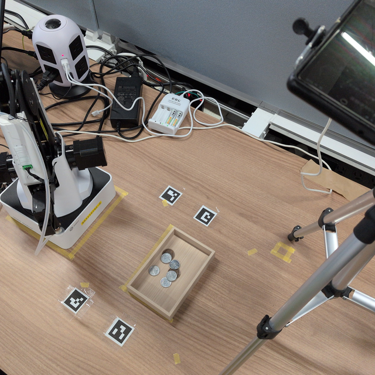
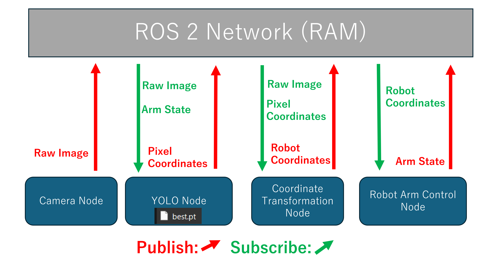
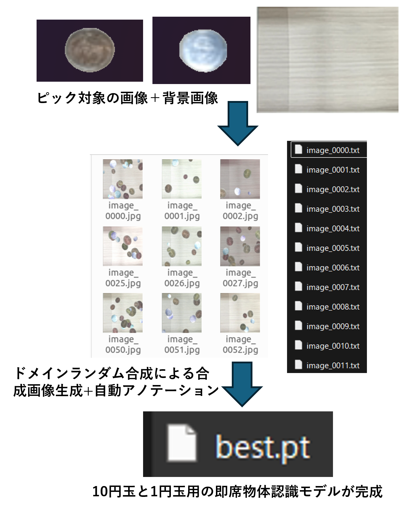
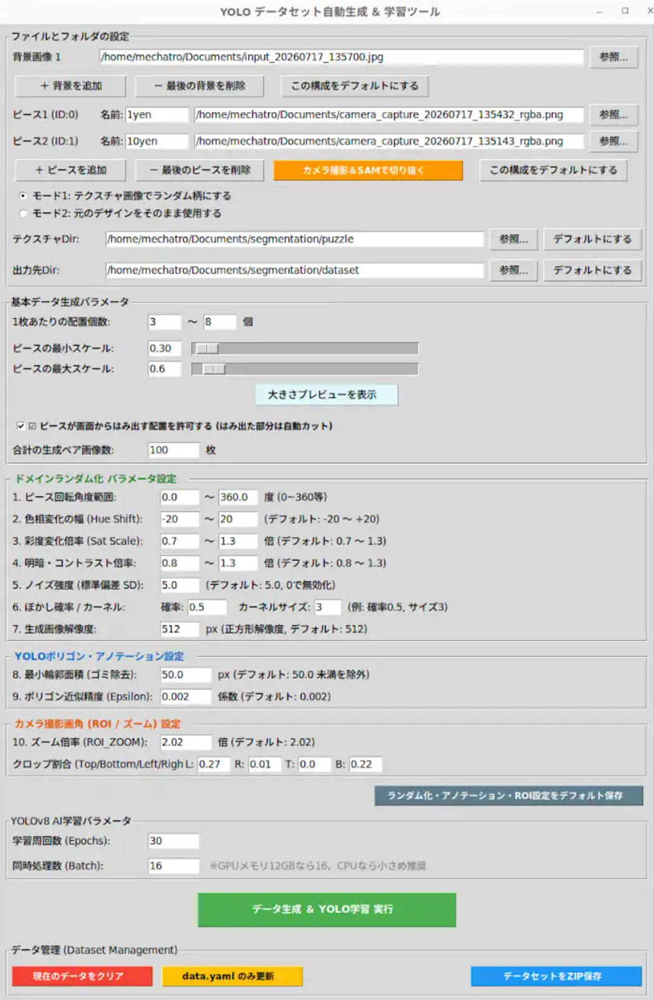

# ROS 2 ロボットアーム自律ビンピッキングシステム

[](https://docs.ros.org/)
[](https://www.python.org/)
[](https://github.com/ultralytics/ultralytics)
[](https://opencv.org/)

ROS 2と深層学習（YOLOv8 / Segment Anything Model）を活用した、多関節ロボットアーム（Dobot Magician）による自律型ビンピッキングシステムです。

外付けカメラからの画像取得、物体検出、カメラ–ロボット間の動的座標変換、吸着エンドエフェクタによるピック＆プレース動作までをROS 2のノード群として統合し、全自動のピッキングサイクルを実現しています。

---

## システム全体図

<!-- システム全体図（実機セットアップ・外観写真など） -->


> [!TIP]
> **【画像の追加手順】**
> 実機環境の全体写真やシステム概要図（推奨ファイル名: `system_overview.png`）を `docs/images/` ディレクトリに配置してください。配置すると上記に自動で表示されます。

---

## 目次
- [システム全体図](#システム全体図)
- [プロジェクト概要と実機での実証成果](#プロジェクト概要と実機での実証成果)
- [実機動作デモ動画](#実機動作デモ動画)
- [システム構成とアーキテクチャ](#システム構成とアーキテクチャ)
- [主要コンポーネントの詳細](#主要コンポーネントの詳細)
- [物体認識モデル生成・学習ツール (SAM2pt)](#物体認識モデル生成学習ツール-sam2pt)
- [使用技術・ライブラリ](#使用技術ライブラリ)
- [ディレクトリ構成](#ディレクトリ構成)
- [セットアップと実行手順](#セットアップと実行手順)

---

## プロジェクト概要と実機での実証成果

### 実機検証で実現した動作
- **対象ワーク**: トレー上にランダムに散乱・配置された硬貨（1円玉および10円玉）
- **吸着・搬送シーケンス**: カメラ映像から対象物をリアルタイムに認識し、最適なターゲットを1枚選定。エンドエフェクタ（サクションカップ）で吸着して回収ボックス（かご）へ搬送。
- **自律的連続動作**: 1サイクルの搬送が完了するごとに認識を再開し、**トレー上の硬貨がすべて空になるまで一連の動作を完全自動で反復実行**できることを実機にて実証済み。

### 実機動作の確認状況
| 機能・動作項目 | 状態 | 説明 |
| :--- | :---: | :--- |
| 外付けUSBカメラの自動認識・画像配信 | **検証済** | PC内蔵カメラを除外し、接続カメラから安定取得 |
| YOLOv8による硬貨のセグメンテーション | **検証済** | 重なり・明暗差に対応した高精度検出 |
| ArUcoマーカーを用いた動的ホモグラフィ変換 | **検証済** | RANSACによりピクセル座標をロボット物理座標(mm)へ変換 |
| 視覚–駆動系の排他同期制御 (インターロック) | **検証済** | アーム動作中の推論停止により誤検出・二重指令を完全抑止 |
| 9段階シーケンスによる吸着・運搬・集積 | **検証済** | 関節補間(MOVJ)と直線補間(MOVL)を組み合わせた確実な搬送 |
| トレーが空になるまでの全自動ループ | **検証済** | 対象物が無くなるまで自律動作を継続 |
| RealSense深度センサとの完全連携 | *未検証* | コード内にパイプライン実装済、深度取得は今後の拡張項目 |

---

## 実機動作デモ動画

実機での連続ビンピッキング実験の動画です。

- **デモ動画リンク**: `https://youtu.be/CnNMiptfTMM`  

---

## システム構成とアーキテクチャ

システムはROS 2のトピック、サービス、アクション通信を活用して疎結合に設計されており、視覚処理と運動制御が同期して動作します。

<!-- システム構成・アーキテクチャ図 -->


> [!TIP]
> **【画像の追加手順】**
> ノード構成や通信データフローを表すアーキテクチャ図（推奨ファイル名: `system_architecture.png`）を作成し、`docs/images/` ディレクトリに配置してください。

---

## 主要コンポーネントの詳細

### 1. カメラノード (`camera_node.py`)
- `/sys/class/video4linux` を走査し、ノートPC内蔵Webカメラを自動除外して外付けUSBカメラ（スマートフォン接続カメラ等）を優先検出。
- カメラ未接続時でも開発・通信テストが継続できるよう、ダミー映像生成フォールバック機能を内蔵。

### 2. 物体検出ノード (`object_detection_node.py`)
- **YOLOv8 セグメンテーション**: 学習済みモデル (`best.pt`) を用いてワークを高精度検出。
- **ターゲット選定アルゴリズム**: 検出された複数の候補から、面積（重なり上位）、確信度、画像中心からの距離を統合スコアリングし、最も吸着に適した1点を自動選定。
- **視覚–運動インターロック**: ロボット移動中（`arm_status = True`）は推論を自動スキップし、手先によるオクルージョンやカメラ振動に伴う誤認識・二重指令を防止。
- **ROI変換と生座標逆算**: デジタルズームおよびクロップ領域内で推論を行い、結果を生カメラ座標系（Raw Pixels）へと正確に幾何逆算。

### 3. 座標変換ノード (`coordinate_transformer_node.py`)
- **動的キャリブレーション**: カメラ生映像に写る4つのArUcoマーカー（物理座標実測済み）を常時検出。
- **RANSACによるホモグラフィ推定**: ノイズや外乱を除外しながら透視投影変換行列（$H$ 行列）をリアルタイム更新。カメラ画角の微小なズレにも頑健に対応。
- **同次座標変換**: ピクセル座標 $(u, v)$ をミリメートル単位のロボット実物理座標 $(X, Y, Z)$ へ変換してパブリッシュ。

### 4. ピック＆プレースノード (`pick_and_place_node.py`)
- **9段階ステートマシン**:
  1. ピック上空安全高さへの高速移動（関節補間: MOVJ）
  2. ピック位置への垂直降下（直線補間: MOVL）
  3. 吸着ポンプON（サービスコール）
  4. ワーク保持・垂直上昇（直線補間: MOVL）
  5. 回収かご上空への高速移動（関節補間: MOVJ）
  6. かご内への垂直降下（直線補間: MOVL）
  7. 吸着ポンプOFF（サービスコール）
  8. かご上空への退避上昇（直線補間: MOVL）
  9. ホーム待機位置への帰還（関節補間: MOVJ）
- 直線補間と関節補間を使い分けることで、周辺障害物への干渉回避とタクトタイム短縮を両立。

---

## 物体認識モデル生成・学習ツール (SAM2pt)

`tools/SAM2pt_ubuntu.py` は、実環境での学習データ収集からアノテーション、モデル学習までをGUI上で一貫して行うための独自開発ツールです。

<!-- SAM2pt パイプライン・データフロー図 -->


> [!TIP]
> **【画像の追加手順】**
> 実画像切り抜きからドメインランダム化合成、YOLOv8学習に至るパイプライン図（推奨ファイル名: `sam2pt_pipeline.png`）を `docs/images/` ディレクトリに配置してください。

### 主な機能
- **ワンクリック・セグメンテーション**: WebカメラまたはIntel RealSenseから静止画を撮影し、MobileSAM（Segment Anything Model）を用いてワーク領域を自動抽出（透過PNG出力）。
- **ドメインランダム化合成エンジン**:
  - 背景画像へのランダム重畳配置
  - オクルージョン（重なり）計算：上下の重なり関係から隠蔽領域を論理演算で除外し、露出部分のみを正確にポリゴンアノテーション化
  - 色相・彩度・明暗コントラスト調整、ガウシアンノイズ、ぼかし/シャープ化、回転、拡大縮小、画像枠外はみ出し自動トリミング
- **ワンストップ学習パイプライン**:
  - YOLO形式のアノテーションファイル（`data.yaml`、ポリゴン座標テキスト）を自動構築。
  - GUI上のボタン1つでYOLOv8セグメンテーションモデル（`yolov8n-seg.pt`）のファインチューニングを実行可能。

### GUI画面（スクリーンショット）

<!-- GUIスクリーンショット配置エリア -->


> [!TIP]
> **【画像の追加手順】**
> `python3 tools/SAM2pt_ubuntu.py` を実行したGUI画面のキャプチャ（推奨ファイル名: `gui_screenshot.png`）を `docs/images/` ディレクトリに配置してください。

---

## 使用技術・ライブラリ

| 分野 | 技術 / ライブラリ | 用途 |
| :--- | :--- | :--- |
| **Robot Middleware** | ROS 2 (Humble), `rclpy` | システム全体のノード間通信（Topics, Services, Actions） |
| **Robot Hardware** | Dobot Magician | 4軸多関節ロボットアーム、サクションカップ（真空吸着） |
| **Motion Planning** | `dobot_msgs` (PointToPoint) | 関節補間（MOVJ）、直線補間（MOVL）の動作制御 |
| **Computer Vision** | OpenCV (`cv2`), `cv_bridge` | 画像取得、ArUcoマーカー検出、RANSACホモグラフィ変換 |
| **Deep Learning** | Ultralytics YOLOv8 (Segmentation) | ワークのインスタンスセグメンテーション |
| **Foundation Model**| MobileSAM / Segment Anything | ワーク輪郭の自動抽出・アノテーション自動化 |
| **GUI Framework** | Tkinter | データ生成・モデル学習統合デスクトップツールのUI |
| **Visualization** | `rqt_image_view` | 認識・推論結果のリアルタイムストリーミング監視 |

---

## ディレクトリ構成

```plaintext
ros2-bin-picking-demo/
├── README.md                           # 本ドキュメント
├── docs/
│   └── images/                         # README掲載用画像フォルダ
│       ├── system_overview.png         # 【要配置】システム全体図
│       ├── system_architecture.png     # 【要配置】システム構成・アーキテクチャ図
│       ├── sam2pt_pipeline.png         # 【要配置】SAM2pt パイプライン図
│       └── gui_screenshot.png          # 【要配置】SAM2pt GUI画面スクリーンショット
├── launch/
│   └── system.launch.py                # システム全体の一括起動Launchファイル
├── dobot_itou01/
│   ├── camera_node.py                  # カメラ画像配信ノード（外付けカメラ自動検出）
│   ├── object_detection_node.py        # YOLOv8物体検出・スコアリング・ROI逆算ノード
│   ├── coordinate_transformer_node.py  # ArUco検出・動的ホモグラフィ座標変換ノード
│   └── pick_and_place_node.py          # 9段階ピック＆プレース動作・状態管理ノード
└── tools/
    └── SAM2pt_ubuntu.py                # SAM切り抜き・合成データ生成・YOLO学習GUIツール
```

---

## セットアップと実行手順

### 前提環境
- Ubuntu 22.04 LTS
- ROS 2 Humble
- Python 3.10+
- Dobot Magician 実機および公式ROS 2ドライバ (`dobot_bringup`)

### 1. ビルド & 環境設定
```bash
# ワークスペースへ移動しビルド
cd ~/ros2_ws
colcon build --symlink-install
source install/setup.bash
```

### 2. システムの起動
実機の原点復帰（ホーミング）完了後、Launchファイルを実行します。
```bash
ros2 launch launch/system.launch.py
```
起動後、Dobot制御システム、カメラ取得、YOLO推論、動的座標変換、ピック＆プレースシーケンス、およびデバッグ表示用の `rqt_image_view` が一括起動します。

### 3. モデル生成ツールの実行（任意）
新しいワークのモデルを作成する場合:
```bash
python3 tools/SAM2pt_ubuntu.py
```
